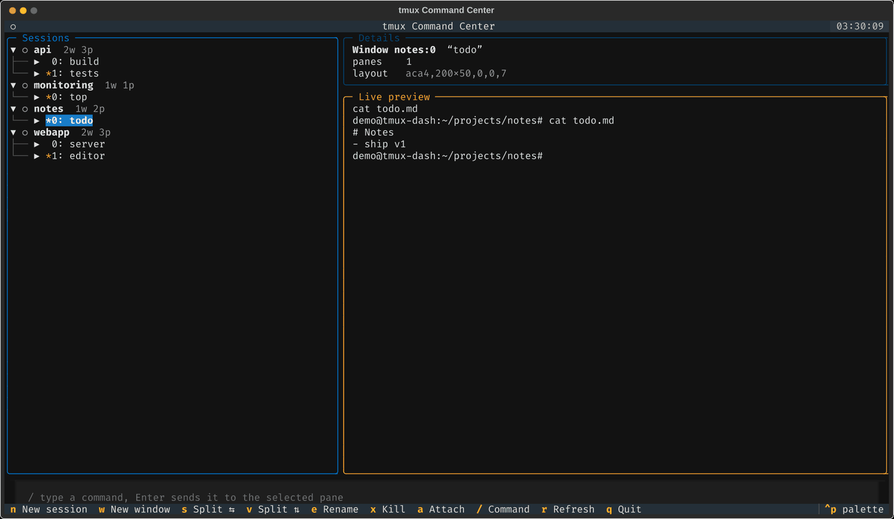
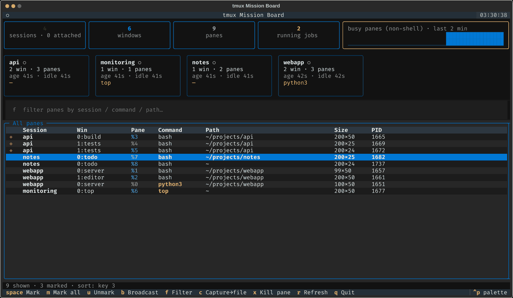
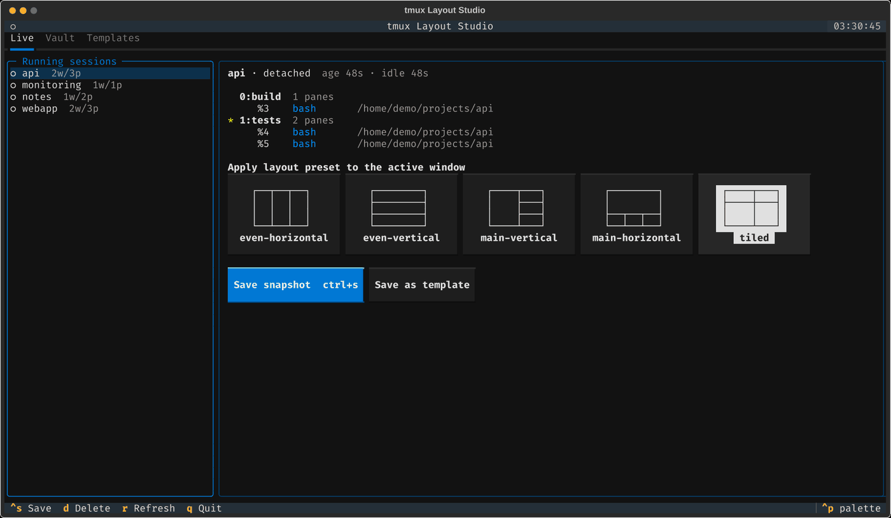
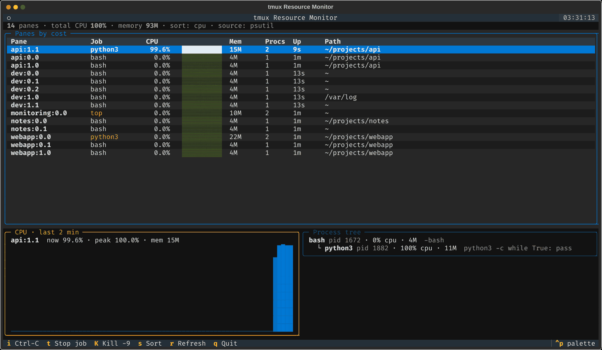
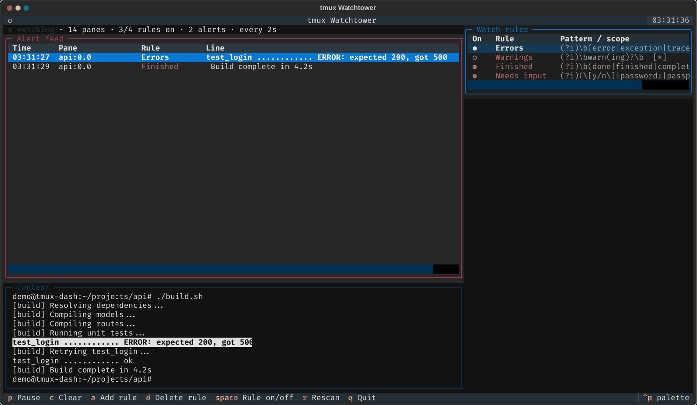
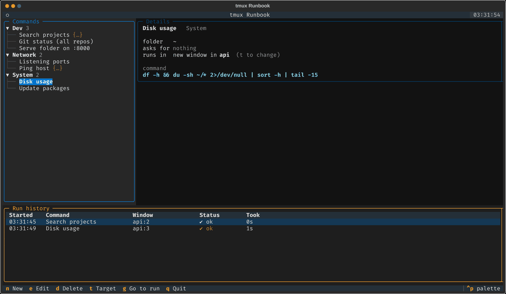

# tmux Dash

**Six terminal dashboards for managing tmux, built with Python and [Textual](https://textual.textualize.io/).**

See every session, window and pane at a glance. Watch output live, broadcast commands, save and restore whole workspaces, find the pane eating your CPU, get alerted when a build fails, and launch saved commands without leaving the terminal.



▶ **[Watch the narrated demo video](docs/demo.mp4)** (1:49)

## Install

```bash
git clone https://github.com/VecBandz/tmux-dash.git
cd tmux-dash
pip install -r requirements.txt
```

You need Python 3.10+ and tmux. Works on Linux and macOS, inside or outside tmux. Running a dashboard in its own tmux pane works great as a control pane.

```bash
python3 1_command_center.py   # or 2_… through 6_…
```

Every dashboard auto-refreshes, accepts mouse clicks, and shows its keys in the footer. Press `ctrl+p` for the command palette and `q` to quit.

---

## The dashboards

### 1 · Command Center: explore and control
A tree of sessions → windows → panes, with a details card and a **live preview** of the selected pane. Type in the command bar to send keystrokes into that pane.

`n` new session · `w` new window · `s`/`v` split · `e` rename · `x` kill · `a` attach · `/` command bar

### 2 · Mission Board: the ops overview
Count tiles, a busy-pane sparkline, a card per session, and a sortable, filterable table of every pane. **Mark several panes and broadcast one command to all of them.**

`space` mark · `m` mark all · `b` broadcast · `f` filter · `1`–`5` sort · `c` save scrollback to file · `x` kill



### 3 · Layout Studio: snapshots and templates
Apply layout presets with a click, **save any session as a snapshot** and restore it later (optionally restarting apps like htop or vim), and launch new sessions from JSON templates you edit right in the app.



### 4 · Resource Monitor: what each pane is costing
CPU and memory summed across each pane's whole process tree, a CPU graph, and the process tree for the selected pane. Interrupt, stop or kill runaway jobs.

`i` Ctrl-C · `t` stop job · `K` kill -9 · `s` sort



### 5 · Watchtower: alerts from pane output
Watches every pane and raises an alert when new output matches a rule (errors, "done", password prompts…) or when a long job finishes. Press `Enter` on an alert to see the surrounding lines. Rules are yours to add and toggle.

`p` pause · `c` clear · `a` add rule · `space` rule on/off · `d` delete rule



### 6 · Runbook: saved commands
A categorized library of commands. Use `{{name}}` placeholders to be asked for values at run time. Each run opens in its own tmux window, and the history shows **running / ok / failed** with the exit code and how long it took.

`enter` run · `n` new · `e` edit · `d` delete · `t` target session · `g` go to run



---

## Building a master panel
Dashboards 4–6 are **embeddable Textual widgets** (`ResourceMonitor`, `Watchtower`, `Runbook`), each with a small standalone app wrapper. Drop them into tabs of your own app:

```python
from textual.app import App
from textual.widgets import TabbedContent, TabPane, Footer
import importlib
ResourceMonitor = importlib.import_module("4_resource_monitor").ResourceMonitor
Watchtower = importlib.import_module("5_watchtower").Watchtower

class Master(App):
    def compose(self):
        with TabbedContent():
            with TabPane("Resources"): yield ResourceMonitor()
            with TabPane("Alerts"):    yield Watchtower()
        yield Footer()

Master().run()
```

They post messages (`ResourceMonitor.Hot`, `Watchtower.AlertRaised`, `Runbook.RunFinished`) that a parent app can turn into badges or notifications.

## Where data is stored
Everything stays on your machine:

| What | Where |
|---|---|
| Snapshots | `~/.config/tmux-dash/snapshots/` |
| Templates | `~/.config/tmux-dash/templates/` |
| Watch rules | `~/.config/tmux-dash/watch_rules.json` |
| Runbook | `~/.config/tmux-dash/runbook.json` |
| Scrollback captures | `~/tmux-captures/` |

## Files
| File | Purpose |
|---|---|
| `tmuxlib.py` | tmux backend (sessions, windows, panes, actions, snapshots) |
| `procs.py` | process info per pane (uses psutil if installed, else `ps`) |
| `common.py` | shared pop-up dialogs |
| `1_…6_*.py` | the dashboards |

## License
MIT. Made by **VecBandz**.
